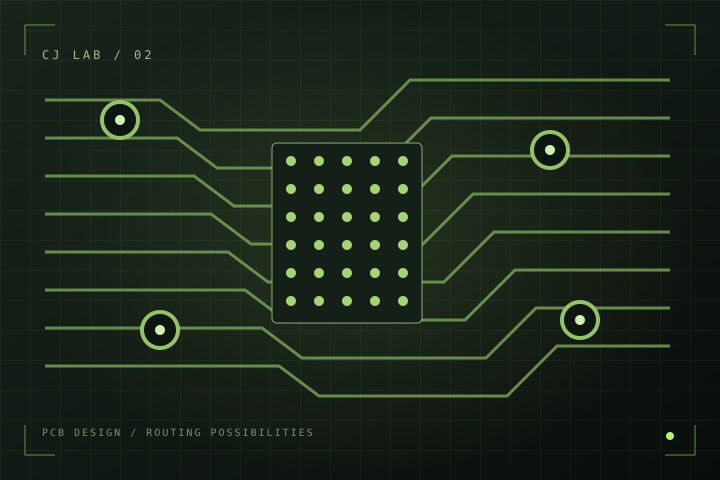
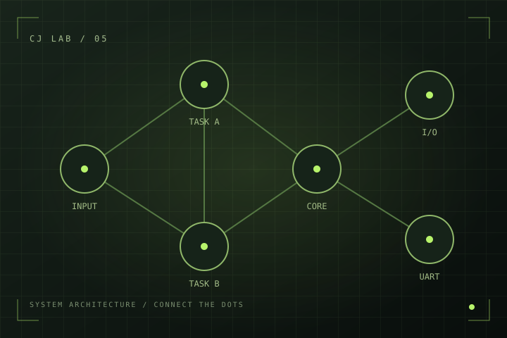

# 你的项目名称

## 一、项目介绍

写下项目背景、目标和准备实现的功能。

- 功能一：填写自己的内容。
- 功能二：填写自己的内容。

## 二、硬件设计

下面是示意素材。请替换成自己的电路板实拍，例如将 `board.jpg` 放入当前项目的 `images` 文件夹，然后改成 ``。



*配图说明：这里填写实际硬件版本与拍摄内容。*

### 2.1 器件选型

写下主控、电源和外设的选型理由。

### 2.2 接口设计

记录接线、引脚和接口约定。

## 三、软件实现

使用反引号插入行内代码，例如 `main()`。

```c
void app_init(void)
{
    // 替换为自己的关键代码
}
```

## 四、测试与结果



| 测试项 | 测试条件 | 实测结果 |
| --- | --- | --- |
| 基础功能 | 填写条件 | 待验证 |
| 稳定性 | 填写条件 | 待验证 |

> 写明测试条件和实测结果，尚未完成的验证可以标记“待验证”。

## 五、问题与复盘

写下遇到的问题、定位过程、解决办法和下一步计划。

可以添加[资料链接](https://github.com/cj6666285)，也可以[跳回硬件设计](#二硬件设计)。
