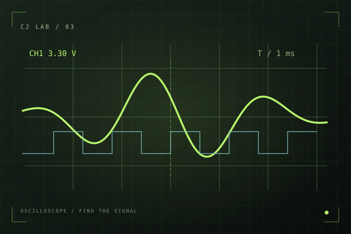

## 一、信号与接口

- 信号来源与电气范围
- 采样率、精度与通信速率
- 接线与电平说明

## 二、采集与传输

### 2.1 采样与滤波

记录采样时序、数据换算、滤波与校准。

### 2.2 缓冲与协议

记录 DMA、环形缓冲、帧格式、校验与超时策略。

## 三、波形与调试

记录采样条件、观测结果与异常定位过程。

*后续替换为实际测量的波形截图。*

## 四、结论与复盘

填写稳定性验证、已知限制与改进方向。

