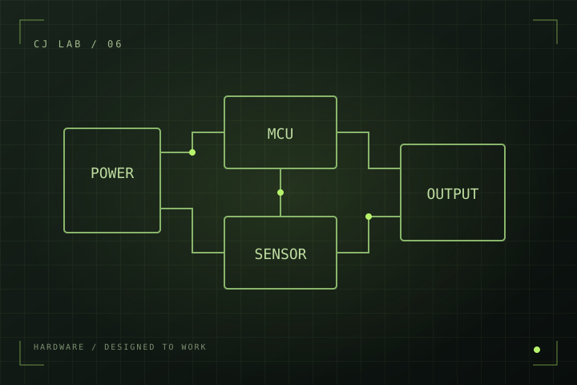

## 一、需求与指标

所有指标均以真实设计与测试结果为准。先填写需求，不把目标值写成实测值。

- 输入条件：填写输入范围、供电方式与使用场景。
- 输出要求：填写电压、电流与负载范围。
- 动态性能：填写纹波、响应、效率和温升目标。
- 保护策略：填写过压、过流与异常处理要求。

## 二、硬件方案

先给出系统框图，再展开关键电路的设计依据。

*示意素材，后续替换为你的实际原理图或系统框图。*

### 2.1 供电与主控

填写供电结构、主控选型、辅助电源与调试接口。

### 2.2 主功率电路

记录拓扑、开关器件、电感电容和驱动器的选型依据。

### 2.3 电压与电流采样

填写采样范围、传感器、滤波、ADC 换算和校准方法。

### 2.4 控制与保护

分别记录硬件与软件保护路径、触发条件和恢复策略。

## 三、软件设计

### 3.1 定时器与 PWM

填写频率、占空比、死区和同步采样时序。

### 3.2 ADC 与 DMA

记录通道、触发方式、数据缓冲和滤波方法。

### 3.3 闭环控制

记录控制周期、算法、参数来源和限幅策略。

### 3.4 保护逻辑

记录异常检测、关断路径和故障状态机。

## 四、测试与调试

附上带测试条件的波形与数据，区分仿真和实测。

| 测试项 | 测试条件 | 结果 | 备注 |
| --- | --- | --- | --- |
| 空载 / 带载 | 待填写 | 待测量 | 待填写 |
| 动态响应 | 待填写 | 待测量 | 待填写 |
| 保护动作 | 待填写 | 待测量 | 待填写 |

## 五、交付资料

- 原理图、PCB 与 BOM 版本
- 源码、固件与使用说明
- 测试记录、问题清单与后续计划

