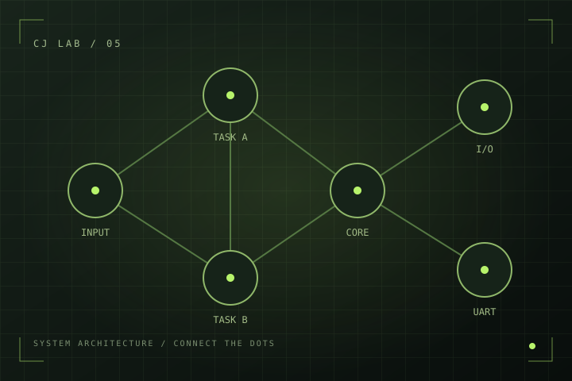

## 一、系统与目标

写明受控对象、输入输出、工作条件和性能要求。

## 二、系统结构

*框架示意，替换为真实系统结构。*

### 2.1 控制模型

说明模型假设、适用范围与参数来源。

### 2.2 控制策略

记录算法、采样周期、执行时序与异常策略。

## 三、实现与调试

填写软件实现、硬件配置和关键调试步骤。

## 四、实验与对比

分别展示预期结果、实验条件、测量数据和误差分析。

## 五、结论与后续

填写已验证的结论、限制和下一步计划。

