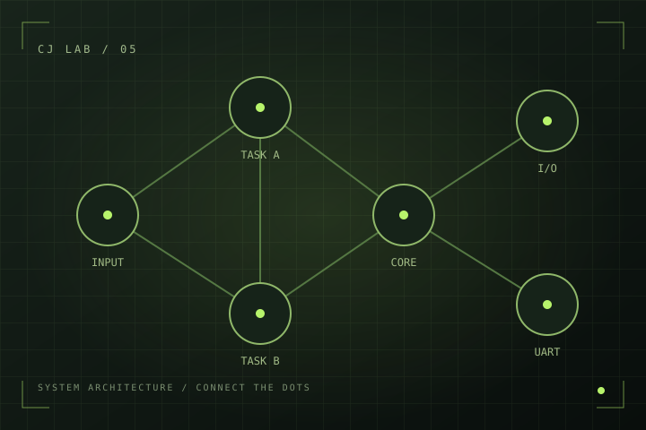

## 一、需求与指标

先说明项目要解决的问题、使用场景和验收标准。

- 项目目标：填写要实现的功能与使用场景。
- 主控与平台：填写实际芯片、开发板和硬件版本。
- 验收指标：填写功能、时序、资源和稳定性要求。

## 二、软件架构

整理模块之间的边界、调用关系和数据流。



*框架示意图，后续可替换为项目的软件架构图。*

### 2.1 启动与初始化

填写启动流程、时钟配置和初始化顺序。

### 2.2 模块与接口

填写驱动层、业务层与接口的设计理由。

### 2.3 任务调度

说明采用轮询、中断或 RTOS 的理由，并记录任务优先级与交互。

## 三、关键实现

记录最值得复用的实现细节，并附实际代码片段。

```c
// 在这里替换为项目关键代码
void app_init(void)
{
    // 初始化流程
}
```

## 四、测试与调试

按测试条件、预期结果、实测结果和结论记录验证过程。

| 验证项 | 测试条件 | 预期结果 | 实测结果 |
| --- | --- | --- | --- |
| 基础功能 | 待填写 | 待填写 | 待填写 |
| 异常处理 | 待填写 | 待填写 | 待填写 |

## 五、交付与复盘

- 源码链接与构建步骤
- 固件版本、配置文件和测试记录
- 遗留问题与下一步计划

