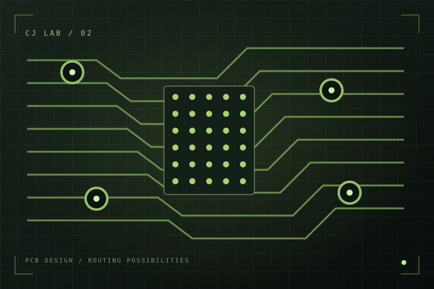

## 一、需求与约束

- 功能与电气要求
- 板框、接口与机械约束
- 成本与生产条件

## 二、设计方案

*设计示意素材，不是实际 PCB。*

### 2.1 原理图

记录电源、时钟、复位、接口与保护措施。

### 2.2 PCB 设计

记录层叠、关键布局、回流路径与设计检查。

## 三、打样与焊接

填写生产版本、器件替代、焊接与目检记录。

## 四、上电验证

- 检查供电与短路风险
- 记录受控上电条件与实际电流
- 验证时钟、复位、通信与核心功能

## 五、改板与交付

记录修改原因、版本差异与归档文件。

